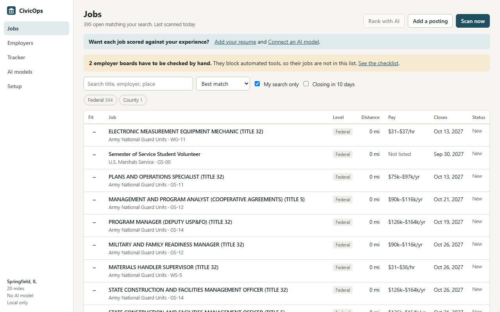
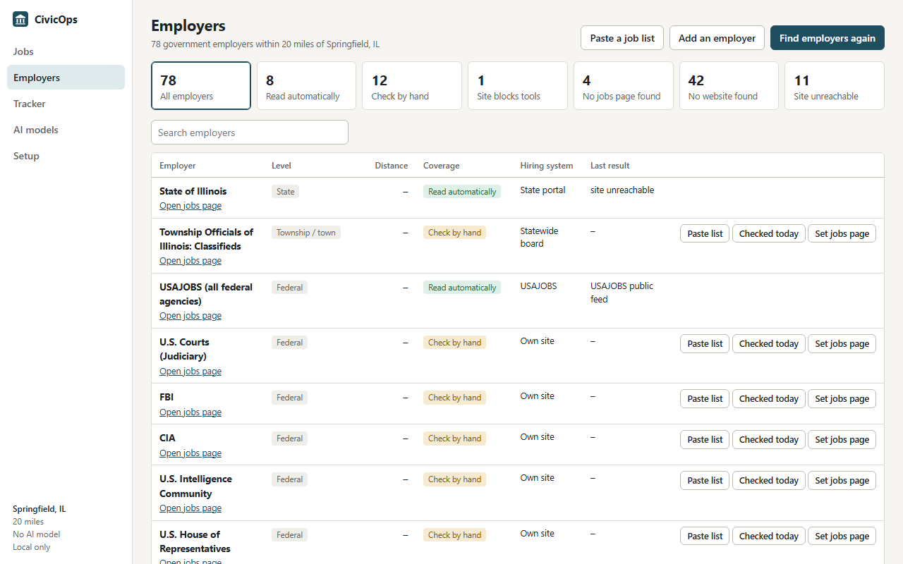

# CivicOps

A local-first AI job search for **government jobs only**: federal, state, county, city, township, and other local
employers within the distance you choose. It finds the employers, collects their postings, evaluates each one against
your resume with an AI model you control, tailors your documents, and tracks your applications.

Inspired by the pipeline idea behind [career-ops](https://github.com/santifer/career-ops). This is an independent
project written from scratch for public-sector hiring, and is not affiliated with it.

**It never applies for you.** You review everything and submit it yourself.

> **Early version (0.1.0).** So far it has been run for real in one area of Ohio, on one PC, with LM Studio. Other
> states, runtimes and cloud services use the same code paths but have not had that testing. If something breaks where
> you live, please [open an issue](../../issues).



*Demo search: Springfield, Illinois, 20 miles, before a resume or an AI model is added.*

## Quick start

1. Install [Node.js](https://nodejs.org) 22 or newer. There is nothing else to install.
2. Download this project (**Code > Download ZIP** on GitHub) and unzip it.
3. Open a terminal in the project folder and start the dashboard:

```bash
node src/cli.mjs serve
```

Then open http://127.0.0.1:4173. The Jobs page walks you through three steps:

1. **Say where you want to work.** A ZIP code or city, and a distance.
2. **Find government employers in range.** The first run downloads Census place files (about 14 MB).
3. **Scan for jobs.**

That is enough to browse and filter jobs. Adding your resume and an AI model is optional, and turns on scoring and
tailored documents.

## How it works

| Stage | What happens |
|---|---|
| **Find employers** | Census data lists every active county, city, village and township in your radius. The CISA .gov registry and Wikidata supply official websites. Each site is followed to its jobs page, and its hiring system is identified. |
| **Scan** | Reads USAJOBS, Workday boards, CivicPlus feeds, structured job data, and plain web pages. PDF postings are read too. |
| **Filter** | Your title words, exclusions, pay floor, levels and distance. No AI needed. |
| **Rank** | Embeddings compare postings to your resume, then a fast model scores the top ones. |
| **Evaluate** | First checks the posting is still open. Then a strong model checks minimum qualifications and eligibility gates, with evidence from your resume, including experience that substitutes for a degree. Your resume stays local if the model is local. |
| **Tailor** | Federal or state/local resume, cover letter, and answers to supplemental questions. A fact check flags any number or credential not in your resume. Each resume gets an ATS check and a plain list of how it meets each requirement. |
| **Interview prep** | Likely panel questions built from the posting's duties, STAR answer outlines from your resume only, gaps to prepare for, and what to bring. |
| **Track** | Government-specific statuses such as Referred, Exam, and Eligible list, plus deadlines, follow-ups, dated history, and why an application ended. The Outcomes summary shows how far applications got by score and level. |

### Evaluation

The model scores five dimensions. The software computes the final score, because models are unreliable at weighted
arithmetic and at applying hard caps.

| Dimension | Weight |
|---|---|
| Minimum qualifications | 35% |
| Experience match | 25% |
| Eligibility (citizenship, residency, exams, hiring paths) | 15% |
| Level fit | 15% |
| Pay | 10% |

Any unmet minimum qualification or eligibility blocker **caps the score at 2.0**, however strong the rest is, because
government HR screens usually reject those outright. An unconfirmed minimum caps it at 3.5, so it can never reach "Apply".
Reports go to `reports/`. Prompts are plain text in `modes/`, so
you can edit them.

**Degree or experience.** Many government postings accept experience in place of a degree ("or an equivalent
combination of education and experience", "experience may substitute year for year"). The evaluation checks every route
the posting allows and shows the arithmetic from your resume's dates. A missing degree is never scored as a blocker when the
posting allows a substitution, unless the evaluation shows your experience does not qualify either.

### Resumes: ATS check and fit

Every tailored resume uses plain headings, a contact line, dated jobs and simple bullets, so applicant tracking systems
(ATS) can read it. After it is made, CivicOps checks it locally and scores it out of 100:

- **Layout:** name and contact at the top, standard headings, no tables, columns, images or symbol bullets, dated jobs,
  sensible length, and that the PDF's text can be read back by software.
- **Posting terms:** which of the posting's key terms the tailored resume uses, which ones your own resume supports but the tailored one left
  out (safe to add), and which ones your own resume does not support (never add them).

No tool can promise how a particular employer's system scores a resume; these are the common, well-known causes of a
misread. Each resume also comes with **How this resume fits the job**: one plain line per requirement saying where the
resume shows it and whether it is Met, Partly met or Not shown. That list is for you and never goes into the PDF.

## What it can and cannot read

The Employers page shows this for your own area. Please read it, because **no tool can honestly promise every job.**



| Source | Coverage |
|---|---|
| **USAJOBS** | Automatic, no key needed. A free [API key](https://developer.usajobs.gov/apirequest/) adds exact radius search and full text up front. |
| **Workday, CivicPlus, JobAps, and plain web pages** | Automatic when the site allows it. Plain pages use AI or a link heuristic, and heuristic results are marked "unverified". |
| **Frontline AppliTrack** (most Ohio school districts and ESCs) | Automatic, with posted and closing dates. A board shared by several districts can be narrowed to one with a `boardFilter` in `extraBoards`. School districts are not found automatically yet, so add them under Employers > Add an employer and turn on the School level. |
| **governmentjobs.com and schooljobs.com (NEOGOV)** | **Not read.** Their `robots.txt` allows named search engines only (checked November 2026), and CivicOps honors that with no override. Many cities and counties post only here. |
| **Taleo, Paycom, UKG, ADP, Cornerstone, Oracle** | Need a real browser. You get a direct link, and can use Paste a job list. |
| **Statewide association boards** (county associations, township associations, municipal leagues, state school boards) | 59 boards in 39 states (22 read automatically), listed in `src/portals.mjs`. Each posting is mapped to its county or town, and postings outside your distance are dropped. See [Statewide boards](#statewide-boards). |
| **Plain-text openings on small government sites** | Read best with a local AI model set up. Without one, the employer is flagged "may describe an opening" for you to check. AI reads can include non-jobs such as board seats, and can miss closing dates, so check the page. |
| **Sites with bot checks** | Reported as blocked, never worked around. |
| **Governments with no website or no jobs page** | Listed so you know. Many small townships only post in local papers or at the town hall. |
| **Federal employers outside USAJOBS** | The FBI, CIA, the courts, Congress and others are listed as direct links. |
| **Government-adjacent employers** | The U.S. Postal Service, Amtrak, the Federal Reserve, the Smithsonian and (in its region) the Tennessee Valley Authority hire on their own sites. They are included by default as links to check by hand, under their own level, which you can switch off in Setup. Jobs you paste or add from them are scored and tracked like any other. |

**Still open?** Before evaluating a posting, CivicOps checks its text for a past deadline (including ones written without
a year, such as "until Friday, November 6th") and for wording such as "this position has been filled". A closed posting
is flagged, and you can still choose Evaluate anyway.

For boards that cannot be read:

1. **Checklist.** Employers > Check by hand lists each board, with a "Checked today" button.
2. **Paste a job list.** Open the board in your own browser, press Ctrl+A then Ctrl+C on its job list, and paste into
   Employers > Paste a job list. Titles, links, pay and locations come across when the board shows them. CivicOps never
   contacts the board. This parser has been tested only on hand-written samples so far.
3. **Add a posting.** Paste any posting and it gets the full evaluation and tailoring.
4. **Alerts.** NEOGOV offers its own email job alerts, which pair well with the paste options.
5. **Ask the employer.** `node src/cli.mjs requests` has your writing model draft a short, polite question to
   governments near you whose jobs the tool cannot read, saved to `output/access-requests/`. **Nothing is sent.** You
   review each draft and send it yourself, in your own name, as one private person. Drafts are limited to a few
   nearby offices, and anything the model invented (a contact detail, legal wording, speaking for a group) is
   flagged. Read the ground rules in [docs/ACCESS_REQUESTS.md](docs/ACCESS_REQUESTS.md) first.
6. **Self-hosted [SearXNG](https://docs.searxng.org)** (optional). Your own search engine reports what search engines have
   indexed from those boards, marked as unverified. CivicOps talks only to your instance, never to the board. It also
   helps find missing websites. This path has been tested only against a simulated search server.

## Statewide boards

Small governments that have no jobs page often post on a board run by their state's county association, township
association or municipal league. CivicOps checks the boards for every state your distance reaches.

| How it reads | Boards (checked November 2026) |
|---|---|
| **Dedicated reader** | Ohio: CCAO County Jobs, Ohio Township Association. Pennsylvania: CCAP Job Center. |
| **Job feed** | League of Arizona Cities and Towns, New Mexico Municipal League. |
| **Page reader** (AI, or a link heuristic without AI) | Florida, Iowa, Idaho and Wisconsin counties; Maine, Nebraska, New Jersey, Oklahoma, Tennessee, Utah, Vermont and Wyoming leagues; NYCOM; New Jersey, New Mexico and Virginia counties; Minnesota townships. Postings that name no town or county are skipped, and the count is shown. |
| **Check by hand** (scripts, a bot check, or no list) | The rest, including California, Texas, Michigan, North Carolina, Kentucky, Massachusetts and Indiana. |

No public statewide board has been found yet for AL, AR, DE, DC, HI, KS, LA, MT, NV, OR, RI or WA. In some of these the
association's site has a bot check, or its job list is for members only.
To add or fix one, edit `STATE_BOARDS` in `src/portals.mjs` (name, url, level, read) and run `npm test`. Please check the
site's `robots.txt` first; CivicOps will not read a board that asks automated tools to stay away.

## Local AI

Everything runs on your machine by default, and privacy starts at **Local only**. Use `node src/cli.mjs ai auto` or the
AI models page to assign detected models.

**Detected automatically:** Ollama, LM Studio, llama.cpp, llamafile, LocalAI, RamaLama, MLX, Jan, GPT4All, KoboldCpp,
Text Generation WebUI, TabbyAPI, vLLM, Lemonade, SGLang, Xinference, Msty, AnythingLLM, Open WebUI.

**Also possible:** any OpenAI-compatible or Ollama server on your network, such as a stronger PC. Private and Tailscale
addresses count as local. Anything else counts as cloud.

### Cloud AI (optional, off by default)

Cloud models stay blocked until you choose **Allow cloud** on the AI models page. Your resume and posting text are then sent
to the service you pick. You can mix them, for example a local model for triage and a cloud model for evaluation.

**Sign in with a plan you already pay for.** Install the company's official command-line tool, sign in once, and
CivicOps uses it. CivicOps never sees your password or sign-in tokens, and runs the tool with its file, shell and web tools
turned off. Usage counts against your plan's limits. The chat websites themselves (chatgpt.com, claude.ai, gemini.google.com)
cannot be connected directly; these tools are the supported way to use a plan.

| Plan | Install | Sign in |
|---|---|---|
| Claude Pro or Max | `npm install -g @anthropic-ai/claude-code` | run `claude`, then `/login` |
| ChatGPT Plus, Pro, Business or Enterprise | `npm install -g @openai/codex` | `codex login` |
| Google account (free tier) | `npm install -g @google/gemini-cli` | run `gemini`, choose Login with Google |
| GitHub Copilot and others, through OpenCode | `npm install -g opencode-ai` | `opencode auth login` |

If you pay for Claude Pro or Max but get billed per use, check whether `ANTHROPIC_API_KEY` is set in your environment:
the Claude CLI uses that key instead of your plan. Remove it, restart the terminal and sign in again. If the Claude CLI
asks you to sign in every time CivicOps runs it, run `claude setup-token` once and set the result as
`CLAUDE_CODE_OAUTH_TOKEN`. (Both tips come from the career-ops project's FAQ; they have not been tested with CivicOps.)

**Or use an API key** (billed per use): Anthropic, OpenAI, Google Gemini, xAI (Grok), Mistral, DeepSeek, Cohere, Perplexity,
OpenRouter, Groq, Together AI, Fireworks AI, Cerebras and Hugging Face. Each has a Get a key link on the AI models page.
Keys are saved in `config/secrets.json` (never uploaded) or read from environment variables such as `OPENAI_API_KEY`.
Any other OpenAI-compatible service, such as Azure OpenAI or a company gateway, can be added under Add your own server,
with an optional key.

Only LM Studio has been tested with live models so far. The other local runtimes and every cloud service use the same
well-known APIs, but have not been run with real keys or installs.

**Choosing a model:** bigger is not automatically better. In testing on one home PC, a full evaluation took about 1 to 3
minutes on a 4B model, about 7 minutes on another 4B model, and more than 10 minutes (the default timeout) on 9B and 27B
models. Your hardware will differ, so use the Test button. Small models can also misread postings, so stronger models are
worth trying for the jobs you care about most, with the timeout raised to match.

| Feature | Why it matters |
|---|---|
| **Per-task models** | Small and fast for triage and page reading, strong for evaluation and writing, plus embeddings. |
| **Test button** | Measures speed, checks structured output, and checks whether the model catches a deliberately missing license. |
| **Small-context handling** | Trims posting text and retries automatically if a model's context window overflows. |
| **JSON recovery** | Uses structured output where available, then parses, then repairs. Handles thinking tags. |
| **Hallucination guards** | AI-read job titles must appear on the page. Links must be real. Claims in tailored documents are fact checked against your resume. |

Settings like the Ollama context size live in `config/profile.json`:

```json
{ "ai": { "providers": { "ollama": { "baseUrl": "http://192.168.1.20:11434", "numCtx": 16384 } } } }
```

## Safety and privacy

- Your resume, profile, keys and job data stay in gitignored local files.
- The dashboard listens only on this computer and rejects requests from other sites.
- Job postings are treated as untrusted. They are fenced off from prompts, and models are told to ignore instructions in
  them. A hostile posting could still skew a score, so read the source posting before relying on a result.
- Agent CLIs run with their editing, shell, and web tools denied, from a temp folder.
- Scraped links cannot reach your private network.
- All AI output can be wrong. Check every requirement and deadline against the real posting. You are responsible for the
  accuracy of what you submit, and applications are often certified as true.

## Command line

```bash
node src/cli.mjs location 43215 --radius 50
node src/cli.mjs discover
node src/cli.mjs scan
node src/cli.mjs ai auto
node src/cli.mjs triage --limit 25
node src/cli.mjs list --top 30
node src/cli.mjs evaluate <jobId>
node src/cli.mjs tailor <jobId> --kind resume
node src/cli.mjs tailor <jobId> --kind interview
node src/cli.mjs requests
node src/cli.mjs status <jobId> Applied
```

Run with no arguments to see everything. Tests: `npm test`.

## Layout

```
src/        geo (Census), discover, ats, sources, pipeline, net (robots, rate limits), pdftext, server, cli
src/portals.mjs   state job portals and statewide association boards (add yours here)
docs/       ACCESS_REQUESTS.md: how to ask boards for a feed or permission
src/ai/     registry (backends), client (chat, privacy, JSON handling, benchmark)
modes/      editable AI prompts
web/        dashboard
cv.md, proof-points.md, config/profile.json    your data
data/, reports/, output/                       generated
```

## Sources

[Census Gazetteer](https://www.census.gov/geographies/reference-files/time-series/geo/gazetteer-files.html) ·
[CISA .gov data](https://github.com/cisagov/dotgov-data) · [Wikidata](https://www.wikidata.org) ·
[USAJOBS APIs](https://developer.usajobs.gov)

## Contributing

Local knowledge helps most: a board in your state, a township's jobs page, or a reader that broke. See
[CONTRIBUTING.md](CONTRIBUTING.md).

## Disclaimer

CivicOps is a local tool, not a hosted service. Your data stays on your computer and goes only to the AI service you
choose. Evaluations are recommendations, and AI output can be wrong: check every requirement, deadline and claim against
the real posting before you apply. Use it within the terms of the sites it reads. The authors are not responsible for
hiring outcomes.

CivicOps is an independent project. It is not affiliated with, endorsed by, or run on behalf of any government agency,
USAJOBS, NEOGOV, or any other job board or vendor named here. It never applies for a job and never sends a message. If
you send one of its drafts, you send it yourself, as yourself, and you are responsible for what it says. Nothing here is
legal advice.

[MIT License](LICENSE).
